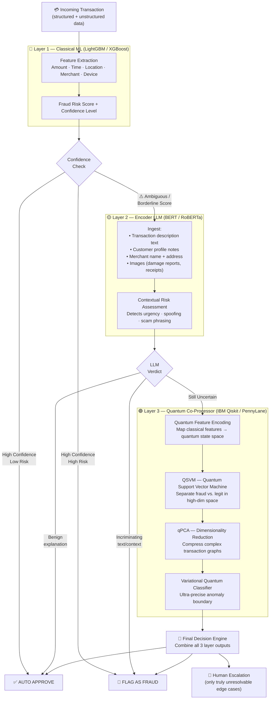
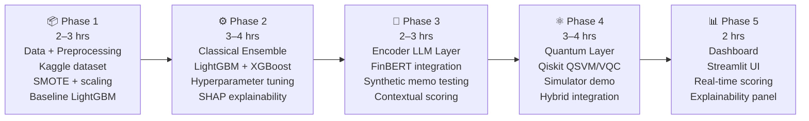

# 🛡️ Quantum Fraud Detection — Hackathon Proposal
### Team: QBIT GLAZERS | RIT Quantathan 2026

---

## 🎯 Problem Statement

> Every payment transfer has a single question to answer: **Is this fraud?**  
> Decision window: **< 200 milliseconds.**  
> Fraud losses from credit cards alone: **\$46 billion by 2026.**

### Why Classical AI Is Hitting Its Wall

| Challenge | Root Cause | Impact |
|---|---|---|
| **Curse of Dimensionality** | Transactions span 10+ variables (geo, device, merchant, behavior, network) — search space explodes exponentially | Models overfit; miss novel fraud patterns |
| **Class Imbalance** | < 1% of transactions are fraudulent (e.g., 990 legit vs 10 fraud) | High false positives — genuine customers get blocked |
| **Static Rule Systems** | Only catch *known* fraud types | New scams (clever wording, synthetic IDs) slip through |
| **Unstructured Data Blindness** | Traditional ML ignores free-text, images, descriptions | "Urgent investment — 200% ROI" goes undetected |
| **Explainability Gap** | Regulators demand auditability — black-box AI fails AML/data privacy compliance | Deployment blockers |

---

## 💡 Proposed Solution: `QuantaShield` — A Three-Layer Hybrid AI System

A **three-stage ensemble architecture** combining:
1. **Classical Gradient Boosting (LightGBM + XGBoost)** — structured data, microsecond latency
2. **Encoder LLM (BERT/RoBERTa)** — unstructured text, contextual fraud signals
3. **Quantum Layer (IBM Qiskit / PennyLane)** — high-dimensional feature mapping, optimization

> [!IMPORTANT]
> The quantum layer is **not a replacement** — it's a precision co-processor that activates only on the hardest ambiguous cases, keeping the system efficient while dramatically improving accuracy.

---

## 🏗️ System Architecture



---

## 🔬 Technical Deep-Dive

### Layer 1 — Classical ML (The Speed Layer)
- **Models:** LightGBM + XGBoost (gradient boosting ensemble)
- **Input features:** transaction amount, timestamp, geolocation delta, merchant category, device fingerprint, user spending velocity, card-not-present flag
- **Output:** fraud probability score (0–1) + confidence interval
- **Latency target:** < 5ms
- **Class imbalance handling:**
  - `scale_pos_weight` in XGBoost / `is_unbalance=True` in LightGBM
  - SMOTE oversampling for minority (fraud) class
  - Optimize for **F1-Score + Recall** (not just accuracy)
- **Why GBM over LR/RF?** Gradient boosting captures non-linear interactions (amount × time-of-day × merchant risk) that simpler models miss.

### Layer 2 — Encoder LLM (The Context Layer)
- **Model:** BERT-base or FinBERT (finance-tuned) / RoBERTa
- **Activated only for:** borderline confidence transactions (cost-efficient)
- **Input:** raw transaction memo text, customer notes, merchant description, free-form address fields
- **What it detects:**
  - Urgency phrasing: *"Rush transfer", "Act now", "Limited time"*
  - Scam signatures: *"Guaranteed 200% ROI", "Refund overpayment"*
  - Merchant spoofing via edit-distance on known fraud merchant names
  - Sentiment anomalies vs. the customer's normal communication pattern
- **Output:** contextual risk modifier (+/- adjustment to base score)

### Layer 3 — Quantum Co-Processor (The Precision Layer)
- **Framework:** IBM Qiskit + PennyLane (interoperable)
- **Backend:** IBM Quantum (cloud) or local simulator for demo
- **Activated for:** the hardest ambiguous transactions (< 5% of volume)

| Quantum Technique | Role in Fraud Detection |
|---|---|
| **Quantum Feature Mapping (Amplitude Encoding)** | Maps high-dim classical transaction vectors into quantum state space — reveals correlations invisible to classical ML |
| **QSVM (Quantum Support Vector Machine)** | Draws optimal fraud/legit boundaries in exponentially large feature spaces using quantum kernels |
| **qPCA (Quantum Principal Component Analysis)** | Compresses complex transaction-graph data exponentially faster — ideal for detecting coordinated fraud rings |
| **Variational Quantum Classifier (VQC)** | Parameterized quantum circuit trained via hybrid optimization — acts as ultra-precise anomaly detector |
| **Quantum Entanglement (Graph Modeling)** | Models interconnected fraud rings (synthetic IDs → shared devices → dummy merchants) as entangled qubit networks |

> [!NOTE]
> Quantum advantage is clearest in **kernel-based classification** (QSVM) where the quantum kernel can represent similarity between transactions in a space that grows exponentially with qubits, while remaining polynomial-time to evaluate classically.

---

## 📊 Dataset & Preprocessing

| Item | Detail |
|---|---|
| **Dataset** | Kaggle Credit Card Fraud Detection (284,807 transactions, 492 fraud — 0.17%) |
| **Features** | V1–V28 (PCA-anonymized), Amount, Time |
| **Augmentation** | Add synthetic text memos (GPT-generated) for LLM layer testing |
| **Split** | 70% train / 15% val / 15% test, stratified |
| **Scaling** | RobustScaler for Amount/Time (outlier-resistant) |
| **Imbalance** | SMOTE + class weighting |

---

## 🖥️ Real-Time Dashboard

**Tech Stack:** Python (FastAPI backend) + Streamlit / React frontend

### Features:
- **Live transaction feed** with color-coded risk scores (🟢 Low / 🟡 Medium / 🔴 High)
- **Per-transaction explainability panel:** which features drove the score (SHAP values for classical layer)
- **Quantum circuit visualizer:** show the VQC circuit for escalated transactions
- **Fraud ring graph view:** network diagram of entangled suspicious accounts
- **KPI dashboard:** live F1, Precision, Recall, false positive rate, avg latency

---

## 📐 Evaluation Metrics

> [!IMPORTANT]
> Accuracy is misleading with 99%+ legitimate transactions. Use these instead:

| Metric | Target | Why |
|---|---|---|
| **Recall (Fraud Detection Rate)** | > 90% | Missing fraud is costly |
| **Precision** | > 75% | Avoid blocking real customers |
| **F1-Score** | > 82% | Harmonic balance |
| **False Positive Rate** | < 2% | Customer experience |
| **Avg Decision Latency** | < 200ms end-to-end | Real-time requirement |
| **AUC-ROC** | > 0.97 | Overall discrimination power |

---

## 🗺️ Implementation Roadmap (Hackathon Timeline)



---

## ⚠️ Challenges & Mitigations

| Challenge | Mitigation |
|---|---|
| **Qubit decoherence / noise** | Use IBM Qiskit noise simulation + error mitigation (ZNE); demo on simulator if hardware slots unavailable |
| **Regulatory explainability** | SHAP values for classical layer; quantum circuit visualization for judges |
| **LLM compute cost** | BERT encoder only activates for borderline ~5–10% of transactions |
| **Hardware access** | IBM Quantum free tier (127-qubit Eagle) + local Aer simulator as fallback |
| **Data privacy** | PCA-anonymized Kaggle dataset — no raw PII |

---

## 🏆 Competitive Differentiators for Judges

1. **Three-layer efficiency:** Quantum only where it matters — not brute-forced everywhere
2. **Full explainability stack:** SHAP (classical) + attention maps (LLM) + circuit viz (quantum)
3. **Real unstructured data handling:** Encoder LLM reads transaction memos — something pure ML cannot do
4. **Fraud ring detection:** Quantum entanglement models interconnected fraud networks
5. **Insurance use case extension:** Same ensemble handles claims with damage images + catastrophe surge scenarios
6. **Production-ready thinking:** Latency budgets, class imbalance strategies, regulatory compliance baked in

---

## 🛠️ Tech Stack Summary

```
Classical ML:    Python · LightGBM · XGBoost · scikit-learn · SMOTE (imbalanced-learn)
Encoder LLM:     HuggingFace Transformers · FinBERT / BERT-base · PyTorch
Quantum:         IBM Qiskit · PennyLane · Qiskit Aer (simulator) · IBM Quantum Cloud
Explainability:  SHAP · LIME · Captum (PyTorch) · Qiskit circuit visualizer
Dashboard:       Streamlit · FastAPI · Plotly · NetworkX (fraud graph)
Data:            Kaggle Credit Card Fraud · Pandas · NumPy · RobustScaler
```

---

## 📌 Key Narrative for Presentation

> *"Classical AI is fast but pattern-bound. LLMs read between the lines. Quantum sees beyond dimensions. QuantaShield combines all three — each model activates only where it excels, creating the first truly adaptive, explainable, real-time quantum fraud detection system."*

